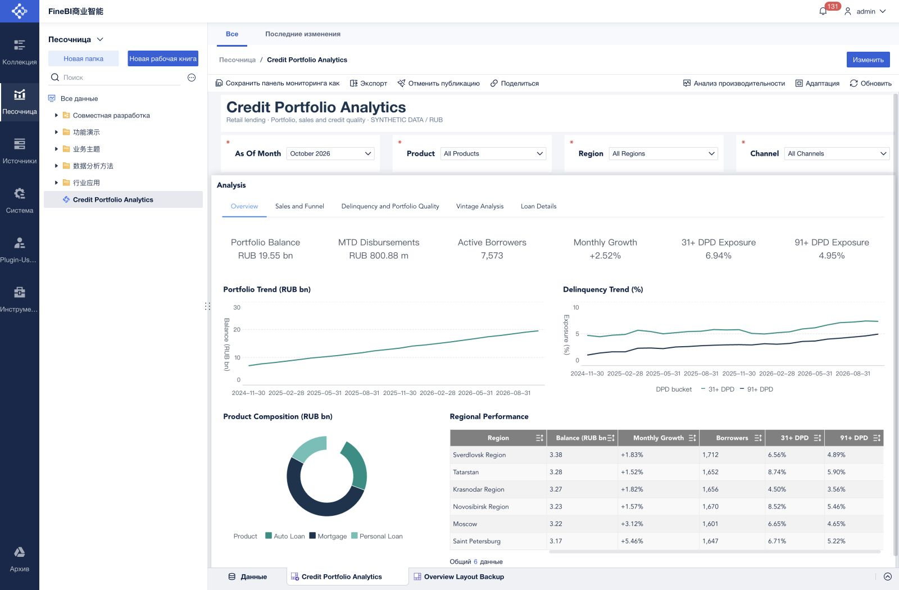

# Credit Portfolio Analytics

A banking BI portfolio project with five native FineBI tabs backed by a reproducible PostgreSQL dataset. It traces applications through funding, portfolio growth, arrears, vintage performance and individual contract activity.



| FineBI tab | What it shows |
| --- | --- |
| **Overview** | Principal balance, monthly disbursements, active borrowers, growth, DPD exposure and product/region mix |
| **[Sales and Funnel](docs/screenshots/finebi/sales-and-funnel.png)** | Submission-to-funding funnel, channel performance, and month-end plan vs actual |
| **[Delinquency and Portfolio Quality](docs/screenshots/finebi/portfolio-quality.png)** | Arrears, DPD buckets, monthly transition matrix and a paged registry |
| **[Vintage Analysis](docs/screenshots/finebi/vintage-analysis.png)** | Origination cohorts, months-on-book matrix and cumulative ever-31+ curves |
| **[Loan Details](docs/screenshots/finebi/loan-details.png)** | Contract terms, principal/DPD history, operations and payment schedule |

The four shared controls retain month, product, region and channel when switching tabs. Clicking a loan reference opens Loan Details with the selected contract and month. Closing the dialog returns to the same registry, including its threshold and page.

- **Database:** [ER diagram and data dictionary](docs/data-dictionary.md) · [PostgreSQL DDL](database/001_schema.sql) · [Reporting views](database/003_views.sql)
- **Semantics:** [Dataset grains and filter rules](finebi/README.md#semantic-layer) · [Metric formulas](docs/metrics.md) · [FineBI SQL and parameter catalog](finebi/readable-filters/datasets.json)
- **Verification:** [FineBI navigation and registry checks](validation/finebi-browser-checks.json) · [SQL parity checks](finebi/readable-filters/validation.json)

The FineBI workbook runs in the local FineBI installation. This repository provides the dataset SQL, build instructions, semantic model and screenshots to recreate it. The separate [FineReport/FineVIS template](dashboard/report/Portfolio_Overview.fvs) is importable into FineReport with a configured `CREDIT_PORTFOLIO` connection. See its [deployment guide](docs/local-overview.md).

**All records are synthetic.** Customer labels are generated identifiers, not people. RUB is the single currency. The fixed reporting date is **October 31, 2026**; reporting history covers **November 2024–October 2026**, with an October 31, 2024 opening baseline and earlier origination/payment history from November 2023.

## Included data

| Entity | Rows |
|---|---:|
| Customers | 15,000 |
| Applications | 19,200 |
| Funded loans | 12,000 |
| Scheduled installments | 783,336 |
| Loan operations | 179,767 |
| Payment allocations | 395,315 |
| Daily loan snapshots | 5,405,234 |
| Monthly loan-age observations | 190,355 |
| Monthly product/branch plans | 1,296 |

Three products, four origination channels, six regions and eighteen branches support filtering and drill-through. The fixture includes on-time payments, temporary arrears and recovery, persistent arrears, early settlement, write-offs, and a deliberately deteriorating Partner channel.

## Start here

1. Use PostgreSQL **16+** and Python **3.9+**. The generator and loader have no third-party Python dependencies.
2. Create a dedicated empty database, for example `credit_portfolio_demo`. Optionally use the supplied `compose.yaml` with a private `POSTGRES_PASSWORD` environment value.
3. Set connection variables and initialize the database:

```bash
export PGHOST=127.0.0.1
export PGPORT=55433
export PGDATABASE=credit_portfolio_demo
export PGUSER=postgres
# Use your private .pgpass/PGPASSFILE for authentication.
# If psql is not on PATH, set PSQL to its absolute executable path.
python3 src/database.py
```

Initialization validates the fixture checksum and loads schema, data, views, indexes and comments in one transaction. It refuses an existing `credit` schema and never drops existing objects. The 37 MiB compressed fixture expands considerably; allow at least **2 GB free disk space** for restore, indexes and temporary files.

4. Create your own reporting LOGIN role, then adapt `database/004_reporting_access.sql` to grant SELECT access. Configure a PostgreSQL connection named **CREDIT_PORTFOLIO** in FineBI. Example JDBC URL: `jdbc:postgresql://127.0.0.1:55433/credit_portfolio_demo`.
5. Follow the [FineBI workbook setup](finebi/README.md) to register the datasets, build the five tabs and configure the registry jump.

From a remote or containerized FineBI server, use a database hostname reachable from that server; localhost refers to the server itself.

## Explore and rebuild

- [Data model and dictionary](docs/data-dictionary.md) · [Catalog export](docs/catalog.csv)
- [Metric definitions](docs/metrics.md) · [FineBI semantic model and lineage](finebi/README.md#semantic-layer)
- [Generation methodology and demo scenarios](docs/generation.md)
- [FineReport pages, datasets and parameters](docs/finereport-datasets.md)
- [Recorded database checks](validation/database-checks.json)
- [Validation scope and results](docs/validation.md)
- [Generated manifest and checksum](data/generated/manifest.json)
- [CSV page samples](data/page-samples/) — default-parameter extracts, not the complete relational dataset

```bash
python3 -m unittest discover -s tests -v
python3 src/generate.py --loans 12000 --seed 20261104 --output /absolute/path/to/new-empty-directory
python3 src/verify.py
```

`verify.py` uses the same explicit database connection variables as the loader. It reconciles the full supplied fixture and refreshes validation evidence and sample exports. It does not load or reset the database.

## Package layout

```text
database/       PostgreSQL schema, views, indexes, comments, optional access grants
data/generated/ Deterministic compressed COPY fixture and row-count/checksum manifest
data/page-samples/ CSV output for the default report parameters
queries/        One SQL file per FineReport dataset
src/            Exact-money ledger, generator, loader, query renderer and verifier
finebi/         Direct-query SQL, semantic catalog, bindings and workbook setup
dashboard/      FineReport/FineVIS template, SQL datasets and installer
tests/          Hand-calculated ledger tests and reproducibility integration test
docs/           Model, metrics, methodology, dataset mapping and live catalog export
validation/     Recorded checks against PostgreSQL 16
```

The data support managerial demonstration, not regulatory reporting, production credit decisions or calibrated loss forecasts. Revenue, profitability, reserves, floating rates, cards, loan restructurings and payment reversals are outside this release.
