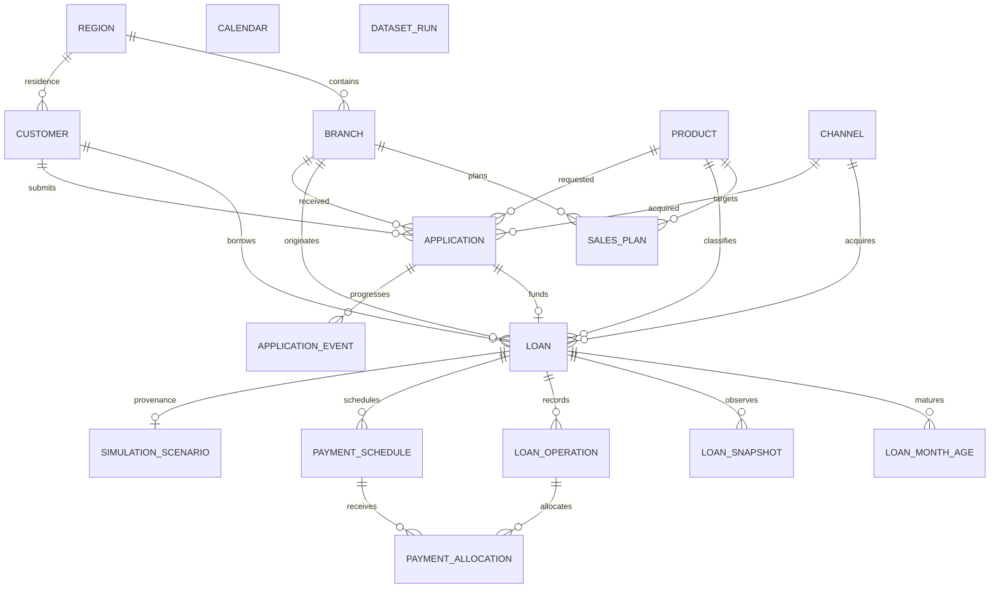

# Data model and dictionary

Schema: `credit`. The SQL DDL is authoritative for types, keys, checks and nullability. [catalog.csv](catalog.csv) is exported from the actual loaded PostgreSQL catalog and includes every table/view column, type and available English comment.

## Relationships

The diagram shows enforced foreign keys. `calendar` supplies date attributes and
`dataset_run` supplies fixture boundaries through query joins rather than foreign
keys. `payment_allocation` references the same loan in both its operation and
installment composite keys.

## Base tables and grain

| Table | Grain / primary key | Meaning |
|---|---|---|
| dataset_run | One fixture, run_id=1 | Seed, generation version, history/report cutoffs, expected loan count and synthetic flag |
| region | One origination region, region_id | English names for six Russian regions |
| branch | One branch, branch_id | English branch name and origination region |
| product | One product, product_id | Personal Loan, Auto Loan or Mortgage |
| channel | One acquisition channel, channel_id | Branch, Online, Mobile App or Partner |
| calendar | One date, calendar_date | Month start/end, year and month number, including future contractual dates through 2050 |
| customer | One synthetic customer, customer_id | Generated label, Standard/Salary/Premium segment, residence region and relationship start |
| application | One submitted application, application_id | Requested amount, submission/approval/funding/terminal dates and final-fixture outcome |
| application_event | One status event, application_id + event_sequence | Ordered status history; same-day events are ordered by sequence |
| loan | One funded contract, loan_id | Contract and origination attributes; one loan per funded application |
| simulation_scenario | One assigned scenario per loan, loan_id | Generator provenance only, not an analytical prediction or observed risk score |
| payment_schedule | One installment/version, loan_id + schedule_version + installment_no | Contractual due date, principal, interest and cancellation date for future obligations |
| loan_operation | One ledger event, operation_id | Disbursement, repayment, prepayment or write-off, with separate principal/interest amounts |
| payment_allocation | One operation/obligation/component allocation, allocation_id | Exact allocation to a scheduled installment and Principal/Interest component |
| loan_snapshot | One loan at one end of day, snapshot_date + loan_id | Outstanding principal, overdue amounts, DPD, bucket, status and historical ever-31+ |
| loan_month_age | One completed monthly anniversary, loan_id + months_on_book | Anniversary date and cumulative ever-31+ at that date |
| sales_plan | One month/product/branch target | Planned amount and contract count, with no channel dimension |

## Important fields

**Identifiers.** `loan_reference` is the English display reference, e.g. LN-0000001. `customer_label` is a generated Customer 000001 label. Neither contains real personal information. A customer can have multiple loans and applications; distinct customer counts are not additive across segments.

**Geography.** The report's region filter uses the **originating branch's region**, not the customer's residence. The two regions are deliberately separate attributes.

**Contract terms.** `original_principal` is the funded principal, `annual_rate` is an annual percentage value, `term_months` is the contractual installment count, and `maturity_date` is the final scheduled due date. `risk_at_origination` is a fixed synthetic Low/Medium/High attribute, not a recalculated current score. Currency is always RUB.

**Application dates.** `approved_date`, `funded_date` and `terminal_date` are nullable. A terminal date applies to Declined/Withdrawn outcomes; Pending and Approved cases remain in progress. The `outcome` column describes the fixture's final state: historical reports must use dated outcomes or `application_event`, rather than treating it as the status at all past dates.

**Closure.** `actual_close_date` and `close_reason` are populated only for closure observed by the fixture cutoff. Reasons are Repaid, Early Settlement or Written Off. A historical card must mask closure attributes if the selected date precedes actual closure. Closed loans retain zero-balance daily snapshots through the final report date.

**Schedules.** `schedule_version=1` and `effective_from=issue_date` in this release. Future extension can add versioned restructuring logic, but the present checks deliberately permit only version 1. `principal_due` and `interest_due` preserve the original contractual amounts even after early closure. `cancelled_on` marks installments whose due dates follow observed closure; it does not erase cash already allocated to their principal during prepayment.

**Operations.** Amounts are positive. DISBURSEMENT increases principal; REPAYMENT, PREPAYMENT and WRITE_OFF reduce it. REPAYMENT and PREPAYMENT are cash receipts; WRITE_OFF is debt extinguishment. An operation is allocated to the same loan by a composite foreign key. Allocations are unique by operation/version/installment/component. Disbursements have no installment allocations.

**Snapshots.** `principal_balance` already includes `overdue_principal`. `overdue_interest` is separate. `dpd` ages the oldest unpaid dated obligation; see [metrics](metrics.md) for boundaries. `ever_31_plus` persists after a cure or closure. Snapshot history begins at the later of loan issue and October 31, 2024; monthly-age flags retain relevant earlier behavior.

**Plans.** `plan_month` is the first day of the month. `planned_amount` is a full-month synthetic target. Channel filtering must not create a fabricated channel target.

## Views

| View | Purpose and caution |
|---|---|
| v_loan_dimension | Funded contracts plus English labels and origination cohort; closure attributes describe the final fixture |
| v_snapshot | Daily snapshots plus immutable origination attributes |
| v_month_end_snapshot | Actual calendar month-end snapshots, retaining closed contracts |
| v_portfolio_monthly | Product/region month-end balances and DPD exposure; filtered SUM may be NULL for an absent bucket |
| v_sales_monthly | Final-fixture monthly plan versus actual at the target grain; use query 06 for historical mid-month cutoffs |
| v_monthly_transition | Same-loan consecutive month-end transitions, including closure/write-off destinations |
| v_schedule_actual | Final-fixture allocation totals; use query 13 for historical as-of schedule detail |

## Join rules

Loan-to-schedule, loan-to-operation and loan-to-snapshot are all one-to-many relationships. Do not join their raw rows and then sum amounts: aggregate each fact to its required grain first. Every supplied query follows this rule. Dated snapshots provide stocks; operations provide flows; monthly-age observations provide cohort outcomes. These facts answer different questions and should not be merged into one unrestricted flat table.
