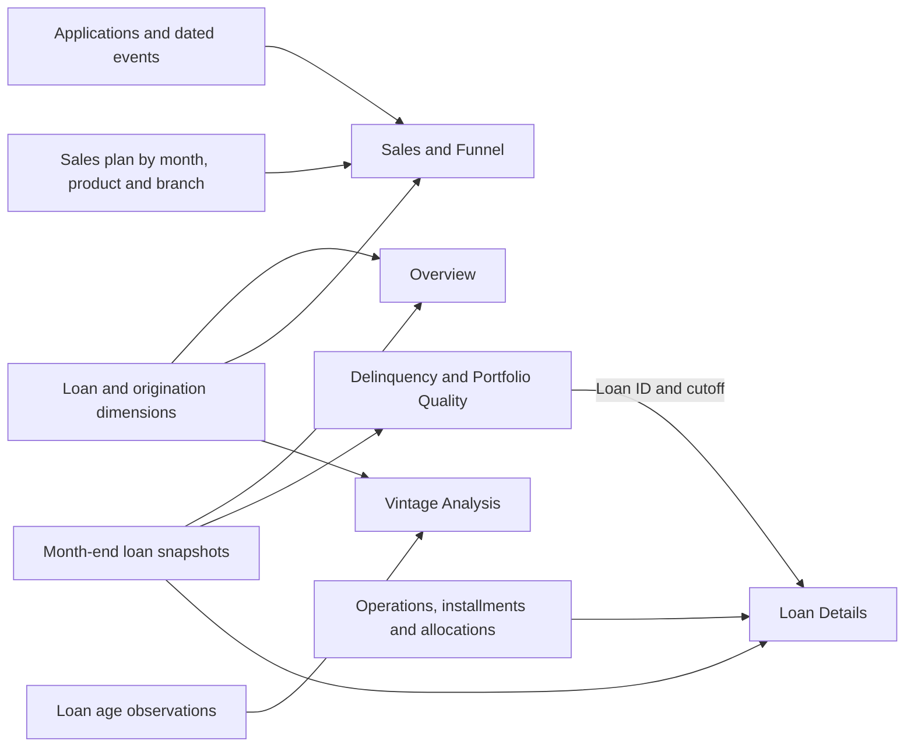

# FineBI workbook and semantic layer

## Recreate the workbook

1. Load the synthetic PostgreSQL database using the [repository setup](../README.md#start-here). In FineBI, configure a PostgreSQL data connection named `CREDIT_PORTFOLIO` with a read-only role and create a `Credit Portfolio` dataset folder.
2. Register the 28 SQL datasets using the names, SQL files, types and defaults in the [label-aware catalog](readable-filters/datasets.json). Use Direct mode. The five filter dictionaries have no parameters. The [dataset catalog](datasets/README.md#dataset-catalog) groups sources by tab and explains their units. The numeric pack provides the same business calculations with numeric filter keys.
3. Add the 28 datasets to one workbook. Build one desktop dashboard with five tabs, using the component mapping below. Use dataset-provided display fields for KPI cards and exact numbers for tables and charts.
4. Place four required single-select controls above the tab component. Use the `label` field from the corresponding dictionary and bind each control to every SQL parameter of its name in the [catalog](readable-filters/datasets.json). Put **Registry Threshold** in the quality tab and bind `p_min_dpd` only to **Loan Registry**.
5. Open the saved dashboard preview with Loan Details active and copy its authenticated preview URL. In `readable-filters/sql/quality_registry.sql`, replace the local preview URL before `?p_loan_id=` with the URL from your installation. Refresh the Loan Registry source in the workbook so it exposes `loan_details_url`. In the registry component's Jump settings, select a web link, insert `loan_details_url` from the dataset and use a full-screen dialog. Keep Loan Details selected as the saved preview's opening tab. Verify the jump from two rows and close the dialog to check the return context.

The included FineBI material is a reproducible build reference. The editable workbook is stored in the FineBI installation. The `.fvs` in `dashboard/report/` is the native template for the separate FineReport implementation.

## Semantic layer

The [physical model and ER diagram](../docs/data-dictionary.md) show relational keys and grain. PostgreSQL [reporting views](../database/003_views.sql) add origination attributes and normalized facts. FineBI queries aggregate each fact at the grain below. Register the result datasets independently to preserve their denominators and avoid multiplying one-to-many rows. See the [metric contract](../docs/metrics.md) for formulas and reporting boundaries.

| Tab | Results and grain | Component and filter rules |
| --- | --- | --- |
| Overview | One KPI row per selection, one point per month/series, one row per product or region | Six cards, two lines, product donut, region table. Stocks use month-end principal, including overdue principal. Distinct borrowers cannot be added across regions or products. |
| Sales and Funnel | One KPI row, one value per funnel stage, funding by month or channel, one plan row per product, one funnel row per channel | Six cards, funnel, line, bars and two tables. Funnel counts applications submitted in the month with outcomes known at the cutoff. Funded-date disbursements use the issue date. Plan vs Actual covers all channels by design. |
| Delinquency and Portfolio Quality | One KPI row, one total per DPD bucket, one matrix cell per opening/closing bucket pair, one registry row per eligible contract | Six cards, DPD bars, color table and detailed registry. Matrix rates use the opening contract count, excluding new issues. Registry Threshold affects only the registry. |
| Vintage Analysis | One KPI row, one cell per origination cohort and MOB, one observed point per selected cohort and MOB | Six cards, color table and line chart. Sort cohort months chronologically and MOB numerically. Display `cell_label` so immature/unavailable cells show a dash. MOB rates use the original contracts from cohorts eligible at each age. |
| Loan Details | One selected contract at cutoff, one point per month-end, one row per operation or installment | Contract identity, six cards, terms, two lines and two tables. The loan ID and month select the contract. Product, region, channel and DPD threshold preserve portfolio context. Operations and payment allocations stop at the cutoff. Future installments can appear if their schedule was already effective. |

`Delinquency Trend.value` and `Vintage Curves.value` are percentage points. Fields such as `ever_ratio` and `transition_ratio` are fractions. Use the units recorded in the [field guide](datasets/README.md#field-use-aggregation-and-units) for amounts, ratios and chart axes.

## Verify

The October 2026 default shows RUB 19.55 bn in principal, RUB 800.88 m in disbursements, 7,573 active borrowers and 1,268 past-due contracts. The historical slice August 2025 / Personal Loan / Moscow / Online with 91+ DPD yields LN-0011359 and LN-0010387 in the registry. Inspect [the recorded browser checks](../validation/finebi-browser-checks.json) and [SQL parity results](readable-filters/validation.json).
